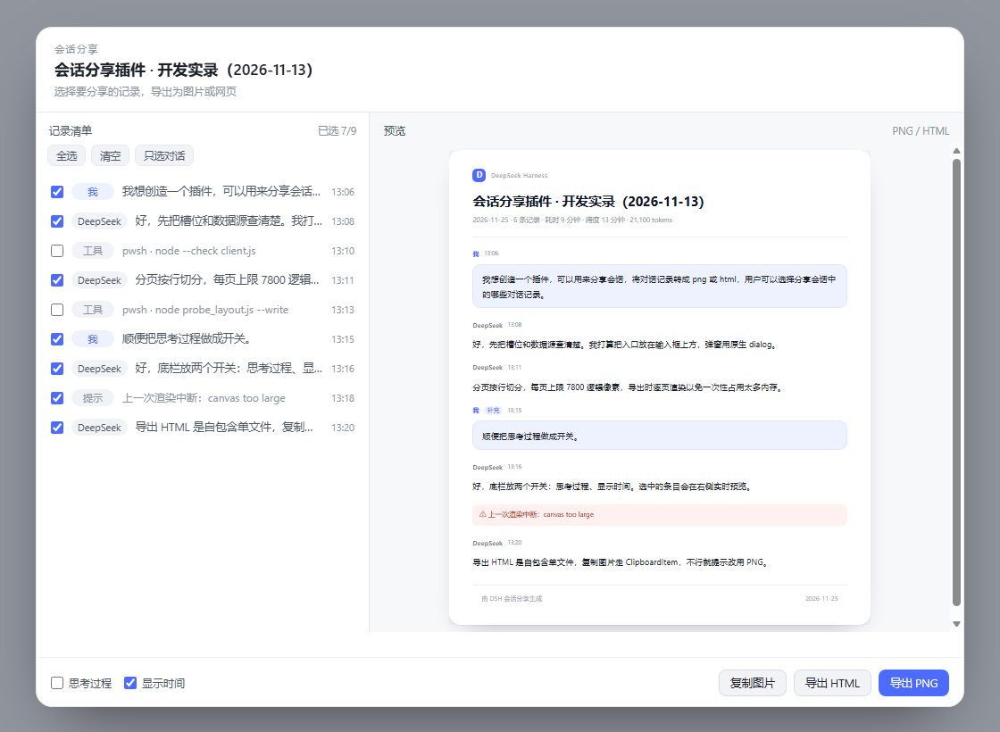
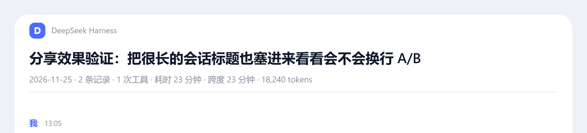
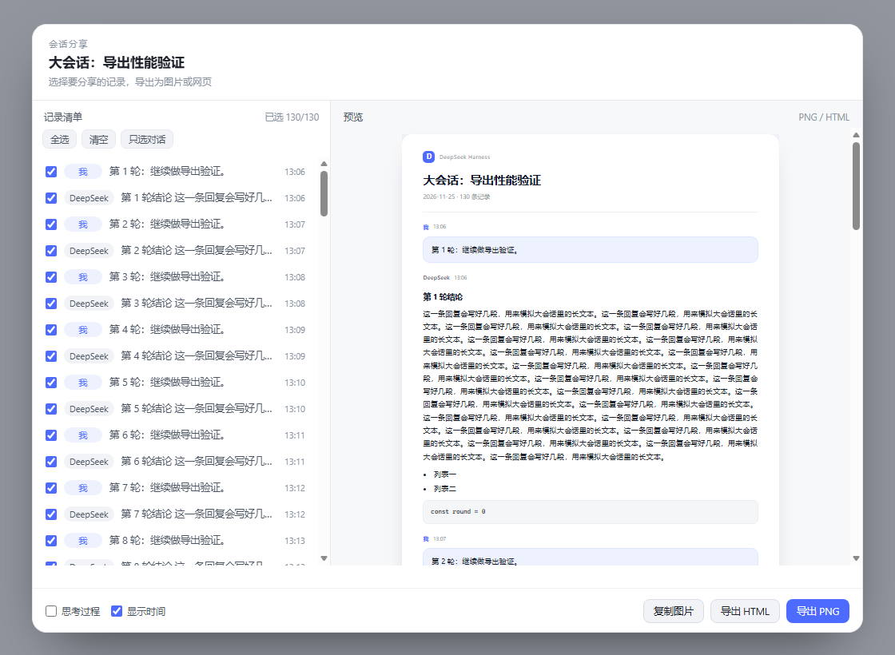

# dsh-share-chat-card

A [DeepSeek Harness](https://github.com/deepseek-ai/deepseek-harness) plugin that exports conversation records as **PNG images** or **one self-contained HTML page**.

Pick the records you want, export them, paste the file into a chat, a doc or an issue.

[中文说明](README.zh-CN.md)



## What it does

A **Share** pill sits in the composer dock. Opening it shows the conversation as a checklist on the left and a live preview on the right; the same document is what you export.

- **Record-level selection** — user messages, model replies, tool calls and interruption notes are separate rows, each with its own checkbox. Defaults to the conversation only; tool calls stay unchecked until you ask for them.
- **Stats header** — every export starts with one line: date, record count, tool-call count, **turn time**, **span**, and tokens when the assistant steps report usage.
- **Two toggles** — include reasoning blocks, show timestamps.
- **Three actions** — copy the PNG to the clipboard, export a single-file HTML page, or export paginated PNG images (`-01`, `-02`, … for long content).



## The two time figures

| Field | How it is computed | Example |
| --- | --- | --- |
| Turn time | `turn.end.time - turn.start.time`, summed over the turns that have at least one shared reply | 5 turns of 3–8 minutes → `26 min` |
| Span | Wall clock between the earliest and the latest shared record | same share → `12 days` |

Turn time only counts a turn when one of its replies is actually shared, and turns that never finished (no `end.time`) are skipped instead of estimated from "now". Tokens come from each assistant step's own `usage.totalTokens` and are summed over the shared steps only, so the number describes the share, not the whole session.



## Install

From the plugin market, or by hand:

```sh
# npm
dsh plugin --profile web add dsh-share-chat-card

# straight from this repository
dsh plugin --profile web add github:Tanloon/dsh-share-chat-card
```

Reload the page after installing. The pill appears in the composer dock above the input box.

## Limits

- Only the **loaded** part of a conversation is listed. Older records appear once the Chat store has loaded an earlier page; the plugin does not read the session log itself.
- Reasonings and tool calls are selectable per record, not per block inside a record.
- The preview is bounded — at most 12 records, 2400 characters of body and 1600 of reasoning each — and says so at the bottom. Export always uses the complete model, so a long conversation with reasoning enabled does not build a multi-megabyte DOM.

## How it is built

- Client-only: `client.js` registers on the `conversation.composer.dock` slot and reads the loaded Chat store through the slot's standard `useChat` / `useSessions` props. The host half (`index.js`) is deliberately empty.
- The dialog uses a native `<dialog>.showModal()` to reach the top layer; the composer container has `transform` / `backdrop-filter`, so `position: fixed` would be clipped.
- PNG rendering is hand-written Canvas layout (880 logical px, 2× scale, pagination by line), with mixed character/word line breaking for CJK and Latin text. No `html2canvas`.
- The HTML export and the preview share one `.dss-doc` stylesheet; the exported file has no external dependencies.
- Copy is registered through `ctx.locale` (`dshShareChatCard` namespace, Chinese and English).

## Requirements

- DeepSeek Harness 0.2.0 or newer
- Node.js 20 or newer

## License

MIT — see [LICENSE](LICENSE).
