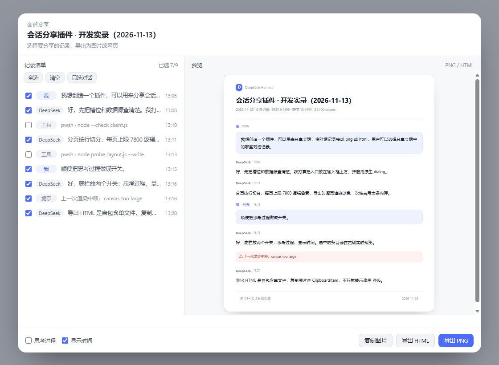
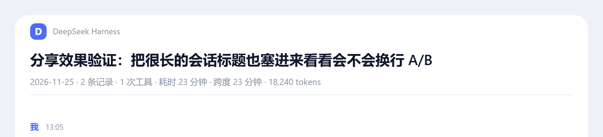
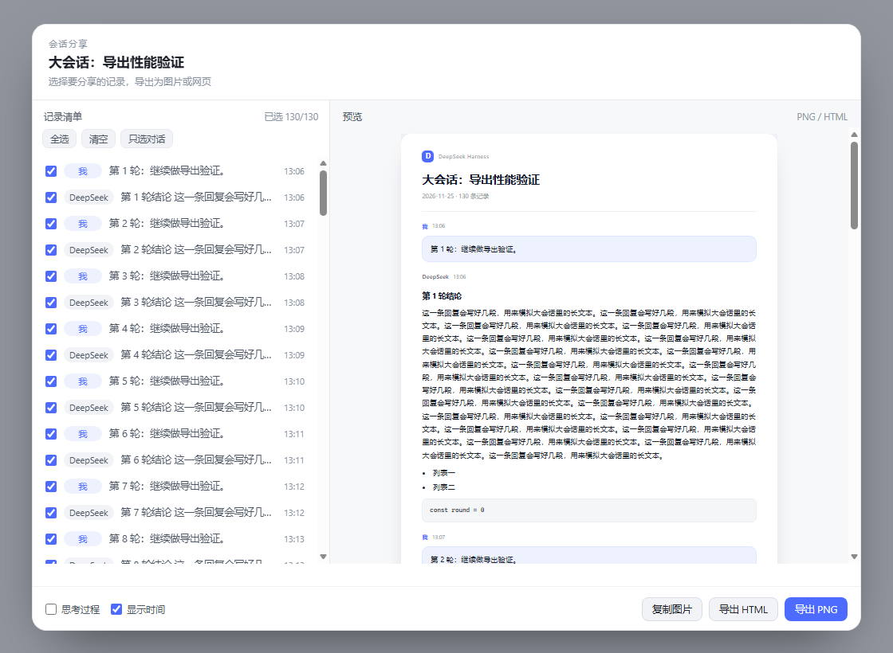

# dsh-share-chat-card

一个 [DeepSeek Harness](https://github.com/deepseek-ai/deepseek-harness) 插件：把会话里的任意几条记录导出成 **PNG 图片** 或 **自包含的 HTML 页面**。

勾选要分享的记录，导出，然后贴进聊天、文档或 issue。

[English](README.md)



## 用起来是什么样

输入框上方有一枚 **分享** 胶囊按钮。点开弹窗：左边是当前会话已加载的记录清单，右边是实时预览，预览渲染的就是最终导出的那份文档。

- **按条选择** —— 用户消息、模型回复、工具调用、中断提示各占一行，各自一个复选框。默认只勾「对话」部分，工具调用不勾。
- **统计头** —— 每份导出顶部一行：日期、记录数、工具调用次数、**耗时**、**跨度**，助手步上报了 usage 时再加 token 消耗。
- **两个开关** —— 思考过程、显示时间。
- **三个动作** —— 复制图片（PNG 进剪贴板，可直接粘贴）、导出 HTML（单文件、零外部依赖）、导出 PNG（长内容自动分页，文件名带 `-01`/`-02` 序号）。



## 两个时间口径

| 字段 | 怎么算 | 例子 |
| --- | --- | --- |
| 耗时 | 选中的每个回合 `turn.end.time - turn.start.time` 相加，只算「至少有一条回复被分享」的回合 | 12 天里聊了 5 个回合，每回 3~8 分钟 → `26 分钟` |
| 跨度 | 选中记录里最早到最晚的墙钟距离 | 同一次分享 → `跨度 12 天` |

回合还没结束（缺 `end.time`）就直接跳过，不拿「现在 - 开始」去估。token 取自每个助手步自带的 `usage.totalTokens`，只累加被分享的那几步，所以这个数字描述的是这次分享，不是整个会话。



## 安装

插件市场里点安装，或者手动：

```sh
# npm
dsh plugin --profile web add dsh-share-chat-card

# 直接从仓库装
dsh plugin --profile web add github:Tanloon/dsh-share-chat-card
```

装完刷新页面，输入框上方就会出现分享胶囊。

## 已知边界

- 只覆盖 **已加载** 的会话窗口：更早的记录要等 Chat 自己加载上一页后才出现，插件不去翻会话日志。
- 思考过程与工具调用的展示粒度按「一条记录」计，不做节点内的逐块选择。
- 预览是「有界视图」：最多 12 条记录、每条正文 2400 字 / 思考 1600 字，末尾会注明截断。导出始终用完整模型，所以大会话勾上思考过程也不会把预览拼成几 MB 的 DOM。

## 实现要点

- Client-only：`client.js` 挂在 `conversation.composer.dock` 槽位，通过槽位标准 props 的 `useChat` / `useSessions` 读已加载的 Chat store；宿主侧 `index.js` 故意留空。
- 弹窗用原生 `<dialog>.showModal()` 进入 top layer —— composer 容器带 `transform` / `backdrop-filter`，`position:fixed` 会被裁切。
- PNG 是手写 Canvas 排版（不引 html2canvas）：880 逻辑宽、2 倍缩放、按行分页，中英文按字符/单词混合断行。
- HTML 与预览共用同一份 `.dss-doc` 样式，导出文件自包含。
- 文案走 `ctx.locale`（`dshShareChatCard` 命名空间，中英双语）。

## 环境要求

- DeepSeek Harness 0.2.0 及以上
- Node.js 20 及以上

## 许可

MIT，见 [LICENSE](LICENSE)。
